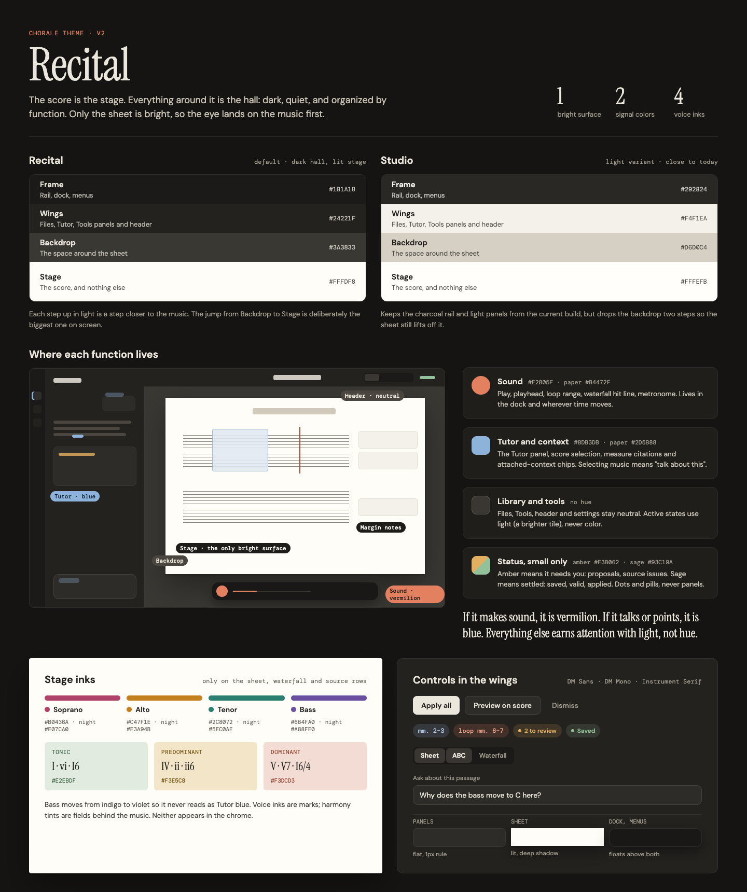
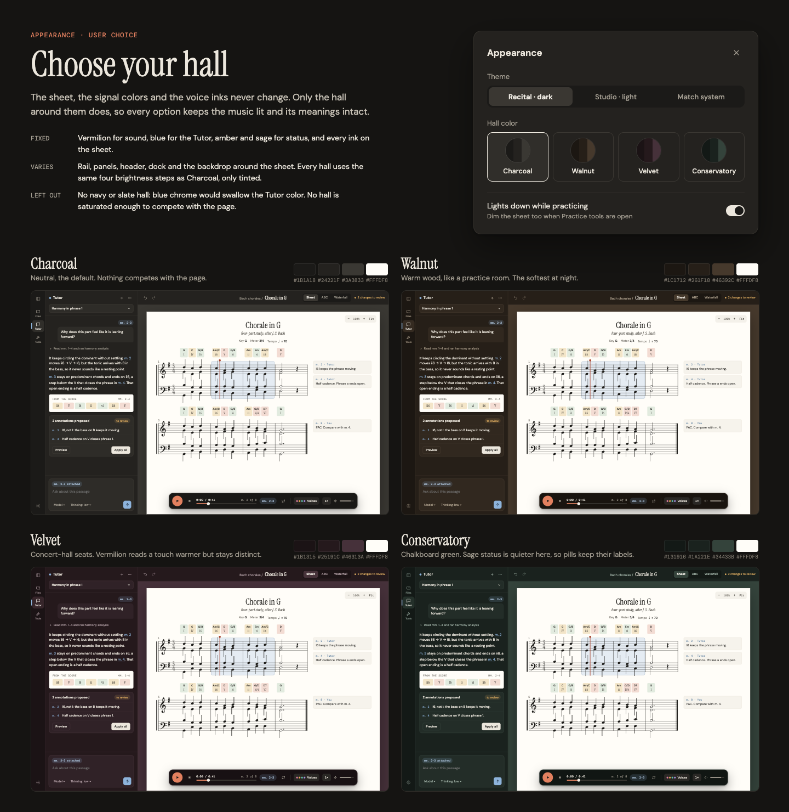
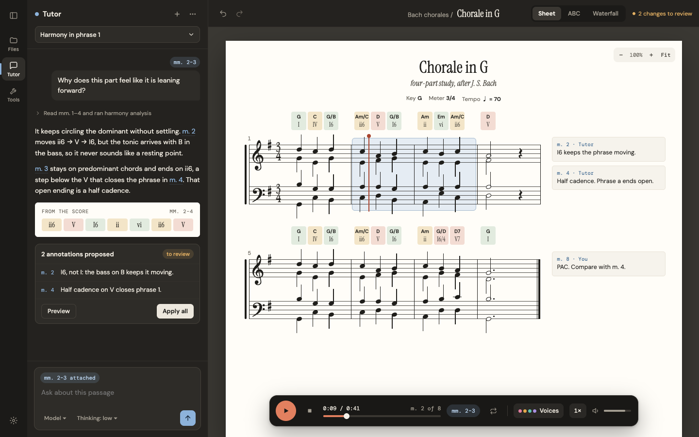
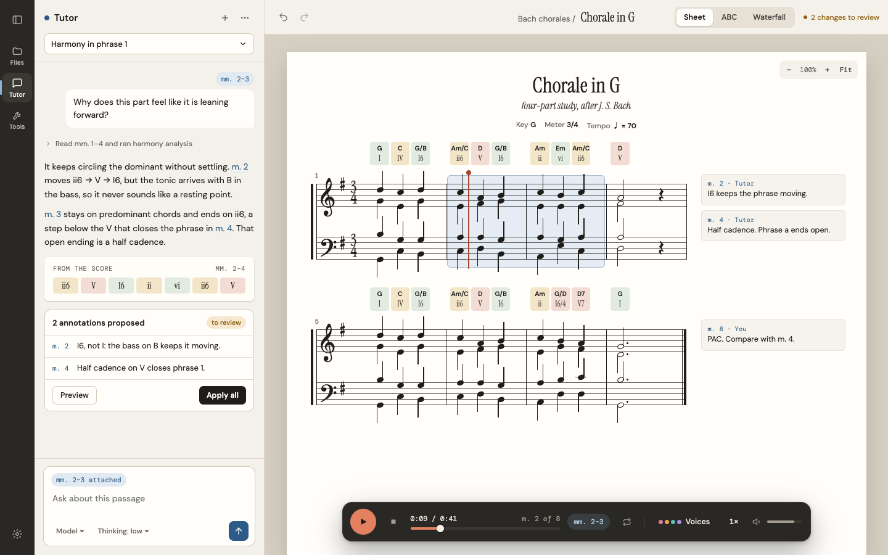
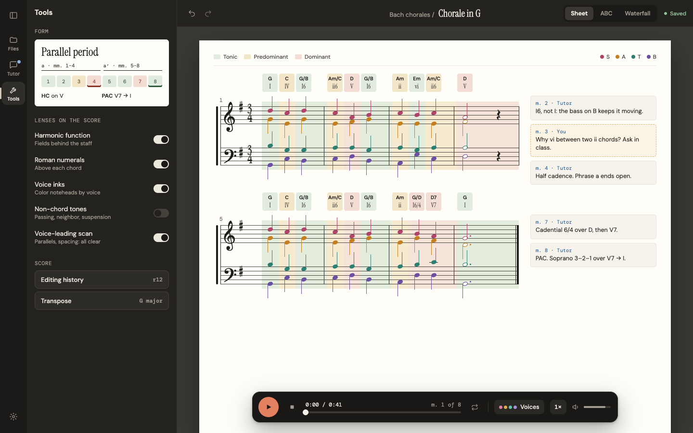
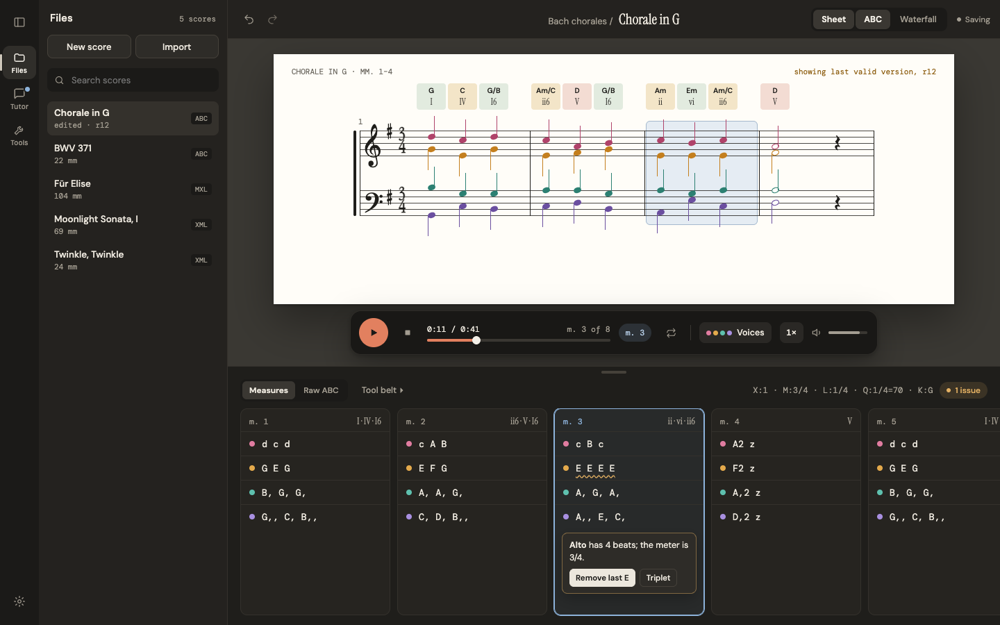
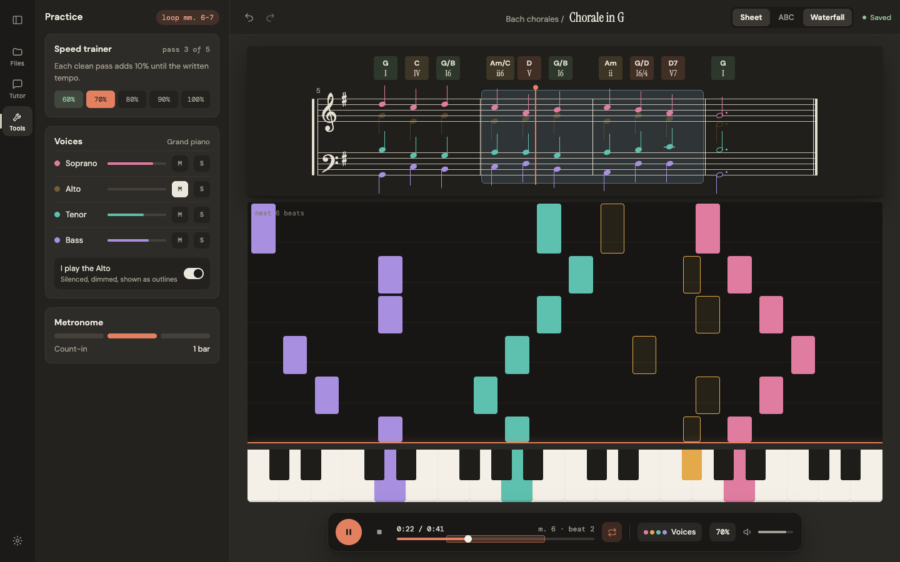

# Chorale Design Language: Recital

> The score is the stage. Everything around it is the hall: dark, quiet, and organized by function. Only the sheet is bright, so the eye lands on the music first.

Status: proposed, 2026-10-25. This spec defines the visual language only. Layout and behavior stay owned by the specs in `spec/`, chiefly [workspace-layout.md](../spec/workspace-layout.md). Where this file and the root [DESIGN.md](../DESIGN.md) disagree on color, type or elevation, this file wins once adopted; the root file remains the reference for paper materials and component recipes until it is retired.

The concept pictures below are rendered from the design canvas. The music on them is an eight-bar SATB study written for the mockups (a parallel period in G, half cadence in m. 4, perfect authentic cadence in m. 8, checked for parallels, spacing and doubling).

## 1. Goals

1. **The sheet stands out.** Today the desk (`#e9e5dc`) and the sheet (`#fffdfa`) differ by a contrast ratio of 1.24, so the score barely separates from the app. In Recital the ratio between backdrop and sheet is 11.5.
2. **Function is readable from color.** A student should know, without reading labels, which parts of the screen make sound and which parts talk to the Tutor.
3. **One coherent, designed theme.** The current CSS carries 188 distinct hex values, 11 font aliases across two sans and two mono families, 16 corner radii and about 250 `!important` overrides. Recital replaces that with a small token set that every surface uses.

## 2. Principles

- **Light is hierarchy.** Brightness, not color, says what matters. Each step up in light is a step closer to the music.
- **Two signal hues, fixed meanings.** Vermilion is sound. Blue is the Tutor and context. Nothing else in the chrome gets a hue.
- **Inks stay on the stage.** Voice colors and harmony tints appear only where music is drawn: the sheet, the waterfall and source rows.
- **Status is small.** Amber and sage are dots and pills, never panel fills.
- **The theme is a choice, the meanings are not.** Users can pick a theme and a hall color. Signal colors, status colors and stage inks never change.

## 3. Theme structure: four tiers of light



Every screen is built from four tiers. Recital is the default theme; Studio is the light variant.

| Tier | Holds | Recital (default) | Studio (light) |
| --- | --- | --- | --- |
| Frame | Rail, dock, menus, popovers | `#1B1A18` | `#292824` |
| Wings | Files, Tools and Chat panels; header | `#24221F` | `#F4F1EA` |
| Backdrop | The space around the sheet and panes | `#3A3833` | `#D6D0C4` |
| Stage | The score sheet, and nothing else | `#FFFDF8` | `#FFFEFB` |

Rules:

- The jump from Backdrop to Stage is the largest brightness step on screen. No other surface may be brighter than the sheet.
- Wings sit directly on the frame. Raised elements inside wings (inputs, cards, the composer) use `raised`, one step lighter than the wing.
- In Studio, the sheet separates from the backdrop by shadow more than luminance (ratio 1.5), so Studio keeps the deeper sheet shadow from §9 and must not flatten it.

## 4. Hall colors (user-selectable)



In Recital, the hall around the stage can be tinted. Every hall keeps the same brightness steps as Charcoal and stays low in saturation, so none competes with the page. **Charcoal is the default.**

| Token | Charcoal | Walnut | Velvet | Conservatory |
| --- | --- | --- | --- | --- |
| `frame` | `#1B1A18` | `#1C1712` | `#1B1315` | `#131916` |
| `wing` | `#24221F` | `#261F18` | `#25191C` | `#1A221E` |
| `raised` | `#2E2C28` | `#31281F` | `#302227` | `#232D28` |
| `line` | `#34312C` | `#3A3027` | `#3A2A2F` | `#2B3731` |
| `control-line` | `#45413A` | `#4E4135` | `#503B42` | `#3B4A42` |
| `backdrop` | `#3A3833` | `#46392C` | `#46313A` | `#34433B` |
| `muted` (text) | `#A39D91` | `#B3A591` | `#B5A2A8` | `#A0B1A6` |
| `rail-active` | `#302E2A` | `#352B21` | `#36252A` | `#24302A` |
| `rail-icon` | `#9C968B` | `#A49684` | `#A69398` | `#8E9F95` |
| `segment-on` | `#3A3732` | `#45392C` | `#47333A` | `#34433B` |
| `dock` | `#191816` | `#19140F` | `#181113` | `#111613` |

Character and caveats:

- **Charcoal**: neutral. Nothing competes with the page.
- **Walnut**: warm wood, like a practice room; the softest at night.
- **Velvet**: concert-hall seats. Vermilion reads slightly warmer here but stays distinct.
- **Conservatory**: chalkboard green. Sage status is quieter against it, so status pills must keep their text labels (they always should; see §11).
- **No blue or slate hall.** Blue chrome would swallow the Tutor color. New halls must pass the same checks: wing text at least 12:1, muted text at least 4.5:1, every signal and status color at least 4.5:1 on the wing.

Primary text on all halls is `#ECE7DD`. Studio ignores the hall setting.

### Appearance settings

Settings gains an **Appearance** section:

- **Theme**: Recital (dark), Studio (light), Match system. Match system maps a dark OS preference to Recital and a light one to Studio.
- **Hall color**: four swatch radio buttons, each showing frame, wing and backdrop. Disabled with an explanation when Studio is active.
- **Lights down while practicing**: on by default; dims the sheet itself when the Practice tools are open (§8.8).

Theme, hall and lights-down are display preferences, local to each client like the other `chorale.workspace.*` preferences. They are applied as `data-theme` and `data-hall` attributes on the document root (§12).

## 5. Signal and status colors

Signal and status colors are identical across halls. Each has a value for dark surfaces (frame, wings, dock) and a value for paper (the sheet, Studio wings).

| Role | On dark | On paper | Meaning and uses |
| --- | --- | --- | --- |
| **Sound** | `#E2805F` | `#B4472F` | Anything that plays or marks time: play button, progress fill, playhead, loop range, waterfall hit line, metronome beat, speed trainer current step |
| **Tutor and context** | `#8DB3DB` | `#2D5B88` | The Tutor: panel marker, send button, measure citations, attached-context chips, and the score selection (selecting music means "talk about this") |
| **Pending** (amber) | `#E3B062` | `#8E5F12` | Needs the user: proposals to review, source issues, "showing last valid version" |
| **Settled** (sage) | `#93C19A` | `#3D6A4C` | Done: saved, valid, applied |

Tints for chips and selections are the dark value at 14 to 18% alpha on dark surfaces (for example `rgba(141,179,219,0.16)`) and fixed paper tints on the sheet (selection fill `rgba(225,233,242,0.85)` with a `rgba(45,91,136,0.35)` inset ring).

Rules:

- If it makes sound, it is vermilion. If it talks or points, it is blue. Files, Tools, the header and Settings are neutral; their active states use a brighter tile, never a hue.
- Errors are pending (amber) plus an icon or message. The terracotta currently used for errors (`--color-error: #ad503b`) is retired as an error color because it collides with Sound.
- Vermilion and blue never fill a panel. Their largest use is the 42px play button and the selection rectangle.
- The play button carries a dark glyph (`#1B1A18`) on vermilion (6.2:1).

## 6. Stage inks

Stage inks appear only on the sheet, in the waterfall, and on source rows. They never appear in rails, panels or the header.

### Voices

| Voice | Paper | Night (dark sheet, waterfall, dark ABC strip) |
| --- | --- | --- |
| Soprano | `#B0436A` berry | `#E07CA0` |
| Alto | `#C47F1E` ochre | `#E3A94B` |
| Tenor | `#2C8072` teal | `#5EC0AE` |
| Bass | `#6B4FA0` violet | `#A88FE0` |

- One voice keeps one color in notation (when voice inks are on), the waterfall, the ABC measure rows and the Voices mixer. Today these surfaces use unrelated palettes.
- Bass is violet, not indigo, so it is never read as Tutor blue.
- The four inks also step in lightness, so they remain distinguishable in grayscale and for common color vision deficiencies. Noteheads stay ink black unless the "Voice inks" lens is on.

### Harmony function

| Function | Tint (field) | Ink (label) | Examples |
| --- | --- | --- | --- |
| Tonic | `#E2EBDF` | `#2F5A3B` | I, vi, I6 |
| Predominant | `#F3E5C8` | `#74520F` | IV, ii, ii6 |
| Dominant | `#F3DCD3` | `#8A3522` | V, V7, cadential I6/4 |

- Function tints are fields: chord badges and optional bands behind the staff. They are never used for text on their own.
- Roman numerals are set in the serif (§7), the way a theory textbook prints them. Chord symbols use the UI sans at 600.
- On narrow systems, chord badges shrink to the beat spacing and never overlap their neighbors.

### Quoting the score outside the stage

When a panel quotes the score (for example harmony evidence in a Tutor reply, or the form summary in Tools), the quote is drawn as a small paper card (`#FFFDF8`, 6px radius, light shadow) and may use stage inks inside it. This is the only way stage inks enter the wings.

## 7. Typography

Three families, three jobs. IBM Plex Sans and IBM Plex Mono are removed from `src/main.tsx`.

| Role | Family | Use |
| --- | --- | --- |
| Title | Instrument Serif 400 (italic for subtitles) | Score titles, the header title, roman numerals, panel display titles such as the form name |
| Interface | DM Sans 400, 500, 600 | Everything interactive and all running text |
| Music meta | DM Mono 400, 500 | Measure references (`m. 3`), time, revision, ABC source, tracked uppercase section labels |

Scale (px): 11, 12, 13, 14, 15, 17, 20, 28, 34, 40. Running text in the Tutor transcript is 14/1.6. Recurring labels never drop below 11px; uppercase mono labels use 0.06em tracking. The eleven `--font-*` aliases collapse to three: `--font-title`, `--font-ui`, `--font-meta`.

## 8. Surfaces

The layout itself (columns, minimum widths, persistence keys) is defined in [workspace-layout.md](../spec/workspace-layout.md). This section defines how each region looks.





### 8.1 Left rail (frame)

- Frame color, 56px wide, full height. Panel toggle at the top, Settings at the bottom.
- Panel tabs (Files, Tools, Chat, in the order the workspace spec defines) are 48 by 48 with a 10px label under the icon, so students do not have to learn icons.
- The active tab uses the `rail-active` tile with `#F4F0E8` text and a 3px marker on the rail edge. The marker is neutral (`#CFC8BB`) for Files and Tools and Tutor blue for Chat.
- A blue dot on the Chat tab means the Tutor has an unread reply.
- The concept pictures show the tabs as Files, Tutor, Tools; the implemented order and the "Chat" label in the workspace spec take precedence.

### 8.2 Header (wing)

- Three regions as in the workspace spec: Undo and Redo on the left, breadcrumb plus serif title in the center, pane toggles and one status label on the right.
- Pane toggles (Sheet, ABC, Waterfall) are a segmented control: frame-colored track, `segment-on` tiles for open panes.
- Status uses settled for "Saved", muted text for "Saving", pending for "N changes to review".
- Export is not in the header. It stays in the file context menu defined by [score-export.md](../spec/score-export.md).

### 8.3 Stage

- Backdrop fills the workspace. The sheet sits on it with the Stage shadow (§9) and square corners: it is paper.
- The zoom control is a small translucent pill at the sheet's top right, drawn in paper tones.
- The margin annotation rail lives inside the sheet. Margin notes are paper cards (`#F6F3EC`, 1px `#E8E2D7` rule, 5px radius) with the measure reference in paper blue. The user's own notes use a dashed amber outline on `#FBF4E4`, so they read as handwritten and distinct from the Tutor's.
- Score selection uses the context tint. The playhead is a 2px Sound line with an 8px cap.

### 8.4 Playback dock (frame, floating)

- The dock is always dark, in both themes, so it reads as hardware. It floats over the backdrop, centered, at most 760px wide, with 16px radius and the Float shadow.
- Vermilion play button; progress track `#3A3732` with a vermilion fill; loop range drawn as a vermilion tint bracket on the track.
- Measure position in DM Mono; the current selection as a blue chip; Voices button with the four voice ink dots; speed and volume in neutral.
- The dock never covers notation. When the lower ABC strip is open, the dock sits in the backdrop between the sheet and the strip.

### 8.5 Chat panel, the Tutor (wing)

See the Study pictures at the top of §8.

- A blue dot beside the panel title marks the Tutor zone.
- User messages sit in `raised` bubbles; the attached range appears above as a blue context chip.
- Reasoning and tool progress collapse to one muted line with a chevron.
- Measure links in replies are Tutor blue with a tinted underline.
- Score evidence is quoted as a paper card (§6).
- Proposal cards use `raised` with a `control-line` border, an amber "to review" pill, rows keyed by blue measure references, and actions "Preview" (secondary) and "Apply all" (primary).
- Composer: `raised` box with the context chip, model and thinking selectors in muted text, and a blue send button. Sending is the Tutor's primary action, so it is the one blue-filled button in the app.

### 8.6 Tools panel (wing)



- Analysis lenses live in Tools: harmonic function bands, roman numerals, voice inks, non-chord tones, voice-leading scan.
- Lens switches are neutral. On is a light track (`#ECE7DD`) with a dark knob; off is `control-line`. They do not use sage, because a lens being on is not a status.
- The form summary (for example "Parallel period", phrase map, cadences) is a quoted paper card.
- Editing history and Transpose sit below as neutral `raised` rows.

### 8.7 Lower ABC strip



- The strip is a darker wing (`#1F1E1B` in Charcoal; `#F4F1EA` in Studio) docked below the stage, with a centered grip.
- Measure view draws one card per measure on `raised`, one row per voice. Each row starts with its voice ink dot; code is DM Mono 13.5.
- The measure synced with the score selection gets a blue outline and blue measure label.
- A source issue underlines the offending row with an amber wave and opens an inline card with the musical explanation ("Alto has 4 beats; the meter is 3/4") and one-click fixes. The header's ABC-level status shows "1 issue" in amber.
- While the source is invalid, the sheet shows the last valid revision and says so in amber.

### 8.8 Practice, lights down



- With "Lights down while practicing" on, the sheet switches to the night stage (`#201F1B`, ink `#E6E0D4`) and voice inks use their night values.
- The waterfall uses the same voice inks as the sheet. Notes the student plays themself ("I play the Alto") are drawn as outlines and dimmed on the sheet.
- The hit line is Sound with a soft glow; lit keys take the voice ink of the note sounding.
- Practice tools (speed trainer, voices mixer, metronome) use wing styling. The speed trainer's current step is Sound; completed steps are settled.

## 9. Shape, elevation and motion

| Element | Radius | Elevation |
| --- | --- | --- |
| Sheet | 0 | Stage: `0 2px 4px rgba(0,0,0,.25), 0 24px 60px rgba(0,0,0,.35)` (Studio: `0 1px 2px rgba(40,30,15,.10), 0 16px 40px rgba(40,30,15,.18)`) |
| Wings, panels, cards in panels | 8 to 12 | Flat, 1px `line` |
| Chips, badges | 4, or pill | Flat |
| Controls | 8 | Flat |
| Dock, menus, popovers, dialogs | 12 to 16 | Float: `0 2px 6px rgba(0,0,0,.22), 0 18px 44px rgba(0,0,0,.32)` |

Four radii (4, 8, 12, pill) replace the current sixteen. Nothing else casts a shadow.

Motion keeps the existing durations (90ms for hover and press, 150 to 260ms for panels and switching). Switching theme or hall cross-fades colors over 180ms. The playhead moves with the music, never on an easing curve.

## 10. Do and don't

- Do use light (a brighter tile) for active states in neutral zones. Don't color them.
- Do use stage inks only on the sheet, waterfall and source rows. Don't tint chrome with voice or harmony colors.
- Do keep vermilion for sound and blue for the Tutor everywhere. Don't use either for decoration, focus rings or links that are not Tutor references.
- Don't add gradients, glass blur or a texture to the hall. The contrast between hall and paper is the effect.

## 11. Accessibility

Measured contrast (WCAG 2.x):

| Pair | Charcoal | Walnut | Velvet | Conservatory | Studio |
| --- | --- | --- | --- | --- | --- |
| Text on wing | 12.9 | 13.2 | 13.8 | 13.2 | 14.9 |
| Muted on wing | 5.9 | 6.7 | 7.0 | 7.2 | 5.0 |
| Tutor blue on wing | 7.3 | 7.4 | 7.8 | 7.4 | 6.3 |
| Pending on wing | 8.0 | 8.2 | 8.6 | 8.2 | 4.9 |
| Settled on wing | 7.8 | 8.0 | 8.4 | 8.0 | 5.5 |
| Sound on frame | 6.2 | 6.3 | 6.5 | 6.4 | n/a |

On paper: Sound 5.3, Tutor blue 7.0, muted text 5.5.

- Color never carries meaning alone: status pills keep their text, the selection has a ring as well as a fill, proposals say "to review", issues say what is wrong.
- Focus rings use a 2px `#ECE7DD` ring on dark and `#1E1D1A` on paper, offset 2px. They are not blue, so focus is never confused with Tutor context.
- Hit targets stay at least 32px in dense rows and 44px for primary controls.
- "Match system" respects `prefers-color-scheme`; Recital also respects `prefers-contrast: more` by raising `muted` to the text color and `line` to `control-line`.

## 12. Token model

Tokens move to role names that do not encode a color. Hall and theme are switched by attributes on `<html>`; components read only the role tokens.

```css
:root,
:root[data-theme='recital'] {
  color-scheme: dark;
  /* tiers: Charcoal hall by default */
  --surface-frame: #1B1A18;
  --surface-wing: #24221F;
  --surface-raised: #2E2C28;
  --surface-backdrop: #3A3833;
  --surface-stage: #FFFDF8;
  --surface-dock: #191816;
  --line: #34312C;
  --line-control: #45413A;
  --rail-icon: #9C968B;
  --rail-active: #302E2A;
  --segment-on: #3A3732;
  --text: #ECE7DD;
  --text-muted: #A39D91;

  /* signals and status, dark surfaces */
  --signal-sound: #E2805F;
  --signal-context: #8DB3DB;
  --status-pending: #E3B062;
  --status-settled: #93C19A;

  /* paper values used on the stage in every theme */
  --stage-ink: #1E1D1A;
  --stage-sound: #B4472F;
  --stage-context: #2D5B88;
  --voice-soprano: #B0436A;
  --voice-alto: #C47F1E;
  --voice-tenor: #2C8072;
  --voice-bass: #6B4FA0;
  --harmony-tonic: #E2EBDF;
  --harmony-predominant: #F3E5C8;
  --harmony-dominant: #F3DCD3;

  --font-title: 'Instrument Serif', Georgia, serif;
  --font-ui: 'DM Sans', system-ui, sans-serif;
  --font-meta: 'DM Mono', ui-monospace, monospace;
  --radius-chip: 4px;
  --radius-control: 8px;
  --radius-panel: 12px;
  --radius-pill: 999px;
}

:root[data-theme='recital'][data-hall='walnut'] {
  --surface-frame: #1C1712;
  --surface-wing: #261F18;
  --surface-raised: #31281F;
  --surface-backdrop: #46392C;
  --surface-dock: #19140F;
  --line: #3A3027;
  --line-control: #4E4135;
  --rail-icon: #A49684;
  --rail-active: #352B21;
  --segment-on: #45392C;
  --text-muted: #B3A591;
}
/* velvet and conservatory follow the same pattern with the values in §4 */

:root[data-theme='studio'] {
  color-scheme: light;
  --surface-frame: #292824;
  --surface-wing: #F4F1EA;
  --surface-raised: #FFFEFB;
  --surface-backdrop: #D6D0C4;
  --surface-stage: #FFFEFB;
  --line: #E0DAD0;
  --line-control: #D3CCBF;
  --text: #1E1D1A;
  --text-muted: #6B675F;
  --signal-context: #2D5B88;
  --status-pending: #8E5F12;
  --status-settled: #3D6A4C;
}

:root[data-lights='down'] .stage {
  --surface-stage: #201F1B;
  --stage-ink: #E6E0D4;
  --voice-soprano: #E07CA0;
  --voice-alto: #E3A94B;
  --voice-tenor: #5EC0AE;
  --voice-bass: #A88FE0;
}
```

Migration from current tokens:

| Current | Becomes |
| --- | --- |
| `--surface-desk`, `--color-paper-2` | `--surface-backdrop` |
| `--surface-paper`, `--surface-chat`, `--surface-tabs` | `--surface-wing` |
| `--surface-raised`, `--color-score-paper` | `--surface-stage` (sheet) or `--surface-raised` (controls in wings) |
| `--color-graphite*`, `--color-on-graphite*` | `--surface-frame`, `--rail-*`, `--text*` |
| `--accent-rust` for playback and grips | `--signal-sound` |
| `--accent-rust` for errors, `--color-error` | `--status-pending` plus an icon |
| `--context-blue`, `--color-annotation-chord-surface` | `--signal-context` tint, or `--harmony-*` for chord badges |
| `--status-sage`, `--color-success*` | `--status-settled` |
| `--color-warning*` | `--status-pending` |
| Waterfall and ABC voice colors (`waterfall.css`, ABC measure rows) | `--voice-*` |
| `--font-display`, `--font-body`, `--font-main`, `--font-serif`, `--font-mono`, `--font-code` | `--font-ui`, `--font-title`, `--font-meta` |

Implementation order once this spec is accepted: introduce the role tokens alongside the old names, move surfaces tier by tier (frame, wings, backdrop, stage), then remove the compatibility aliases and the `!important` overrides they required. Hex values outside `tokens.css` should trend to zero.

## 13. Out of scope

- First run and the library home are parked for a dedicated design pass. Their concept board still uses the v1 palette and is not part of this spec.
- Engraving colors inside abcjs output (staff lines, noteheads in their default state) stay ink on paper.
- Mobile layouts.
