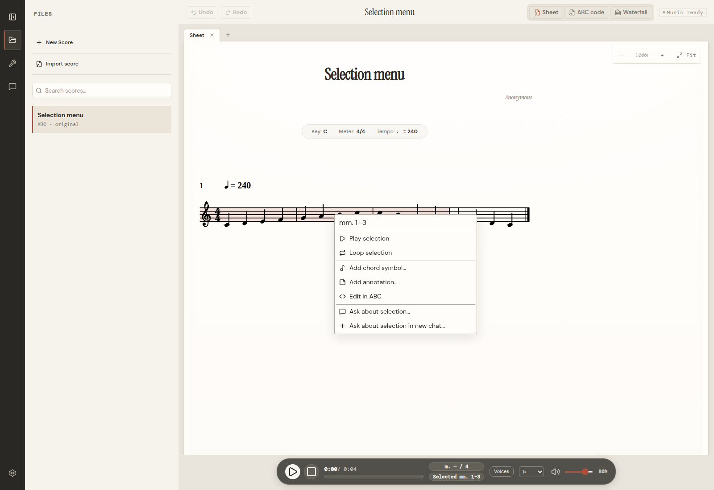

# Score selection context menu — 2026-10-25

Implemented on `feat/score-selection-menu`, based on `920c134`, and verified in an isolated checkout and SQLite store.

## Behavior

- Right-click inside a selected measure range preserves the complete anchor. Outside selects the clicked measure; blank paper does not reuse a stale target.
- Menu: Play selection, Loop selection, Add chord symbol, Add annotation, Edit in ABC, Ask about selection, Ask about selection in new chat.
- Playback uses the shared transport, all audible voices, repeat-aware measure timing, audio-clock stopping, and bounded loop restarts. Stop, seeking, or selecting a different passage cancels the loop. Speed changes preserve its boundaries.
- Chords and annotations use the existing validated editor, history, and storage. Chords default to beat 1 at the beginning of the selected range and expose editable position controls.
- ABC opens Measure Source and focuses the first selected source cell without collapsing the range or replacing a draft.
- Ask uses the active conversation and preserves its composer text. New chat creates one separate conversation. Both focus the composer without submitting a prompt. Attached passage anchors remain associated with their chat during the current document session, independently of later sheet selection.
- Keyboard context-menu/Shift+F10, arrow keys, Home/End, Escape, and Tab dismissal are supported. Menus stay in the viewport under interface zoom. Automatic selection scrolling does not dismiss a newly opened menu; user scrolling of the sheet does.

## Verification

- 251 service/Node tests passed.
- Final complete unit/UI run: 106 files, 994 tests passed.
- `npx tsc -b` and `npm run build` passed. Build retains its bundle-size warning.
- `npm run lint` completed with 51 warnings and no errors.
- `node scripts/score-context-menu-smoke.mjs` passed against an isolated SQLite store: actual right-click range preservation; ABC focus; chord/annotation saves; both chat routes; real WebAudio loop restarts and bounded playback; 150% zoom containment across reloads; keyboard dismissal; no browser page errors.
- The browser smoke supplied a simulated desktop provider bridge and sent no model requests. Live provider response quality was not evaluated.
- The full `npm test` command completed successfully. After fixing a browser-discovered scroll race, the sheet tests, build/typecheck, lint, and browser smoke were rerun.
- Reload persistence was checked for the saved chord and annotation. The small-window/150% zoom check repeats three reloads to exercise the automatic-scroll race. Ordinary web mode was also checked with chat actions disabled.
- An interactive browser pass independently confirmed range preservation, looping, chord save, and ABC focus.

